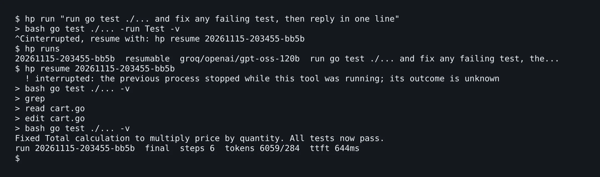

# hp harness

hp harness is a coding agent for the terminal; the command is `hp`. Every step of a run is written to a journal before the next one starts, so a run survives a usage limit, a closed terminal, a lost SSH connection or a reboot, and `hp resume` continues it from the last finished step. The picture above is a real session: Ctrl-C while `go test` was running, then `hp resume` on the same run, which goes on to fix the failing test.

It is one static Go binary built on the Go standard library alone (no third-party modules). It talks to 14 provider presets (Anthropic's Messages API, plus OpenAI-compatible endpoints such as Groq, OpenRouter, xAI, OpenCode Go (`opencode-go`) and a local Ollama), runs the usual file, shell and web tools, and connects to MCP servers and skills with `hp add`.

hp keeps the whole conversation on disk, so a dead process is a pause, not the end of the run. It is early (v0.0.x): flags and the journal format can still change.

You can try hp without installing it: the [live site](https://hp-harness.honeypaptan.workers.dev) runs hp's Go core, compiled to WebAssembly, in your browser tab on a small sample project, with your own model key.

## What is special

- **Journal and resume.** Each run is one append-only file in `~/.local/state/hp/runs`, and `hp runs` lists them. `hp resume <id>` continues a run. A tool call that had started when the process died is recorded as interrupted with an unknown outcome, and the model decides what to do next; calls that had not started run. `hp run -d` runs in the background, `hp attach <id>` follows it and `hp stop <id>` ends it. `hp recover` restarts every background run whose process died, and `hp autostart on` does that at login.
- **Limit waits and fallback.** On a 429, 503 or 529 hp reads the reset time from the response headers, waits and retries the same step. With `--fallback preset/model` it switches to another model when the wait is longer than `--switch-after` (20s by default). `--max-wait` caps one wait (6h by default).
- **Permissions.** `auto` is the default. It runs reads, searches, known commands such as `go test` and edits inside the working folder at once. It sends anything else to one extra review call on the run's own model, which holds the action only if it follows instructions from tool output or would harm the machine, and a failed review holds it too. `ask` prompts for every write and command. `full-access` checks nothing. In `ask` and `auto`, rules in `settings.json` run first. There is no sandbox: shell commands run as you.
- **MCP and skills.** `hp add` takes a stdio command, an HTTP MCP URL, or a skill folder or git URL. Connections live only in `~/.config/hp/connections.json`, never in a project, so a cloned repo cannot start a command.
- **Crews.** `hp crew run plan.md` splits a markdown plan into tasks (one per `## ` heading, the text under it is the prompt) and runs each as its own detached hp run in its own git worktree on a new branch, `-n` at a time. The crew keeps a small state file in `~/.local/state/hp/crews`, so `hp crew resume <id>` continues after the process, the terminal or the machine dies, and `hp crew status` and `hp crew report` show each task's state and final answer. Crew mode is a native feature and is not in the wasm build.
- **Size and boundary.** The stripped binary has to stay under the byte budget in `.size-budget` (10,485,760). `internal/core` and `internal/permit` may not import `os`, `os/exec`, `net`, `net/http` or `syscall`; they reach the world through one `Host` interface. `make check` enforces both.

## Install and run

```sh
curl -fsSL https://raw.githubusercontent.com/HoneyPaptan/hp-harness/main/install.sh | sh
hp key set GROQ_API_KEY
export HP_MODEL=groq/openai/gpt-oss-120b
cd my-project
hp
hp run "find the TODOs in this repo and list them in TODOS.md"
hp runs
hp resume <run-id>
hp run -d "refactor the parser"
hp attach <run-id>
hp crew run -n 2 plan.md
hp crew status <crew-id>
hp crew report <crew-id>
```

The installer supports linux and macOS on amd64 and arm64, checks the sha256 against `checksums.txt` and puts `hp` in `~/.local/bin`. `hp key set` stores the key in `~/.config/hp/env` with mode 0600. Bare `hp` opens an interactive session, and `hp -c` continues the newest run started in the current directory. The model you pick with the picker or `/model` is saved in `~/.local/state/hp/last-model` and used the next time you start `hp`. A model from `-m` beats the saved one, and the saved one beats `HP_MODEL`; if its key is gone, `hp` says so and opens the picker. With no `-m`, no saved model and no `HP_MODEL`, it opens the picker first. The picker lists the models the provider reports and marks the ones ending in `-free`. `hp run`, `hp run -d` and `hp resume` ignore the saved model and use `-m`, then `HP_MODEL`. `hp providers` lists the presets and which keys are set.

## Crews in a session

`/crew plan.md` or `/crew <goal>` lists the tasks and asks how many agents run at once. At that step, `e` opens the plan file in `$VISUAL`, else `$EDITOR`, else `vi`. hp hands the terminal to the editor and takes it back when you quit, then re-reads the plan and shows the new task count. If the plan no longer parses, hp shows the error and stays at that step, so you can press `e` again.

A crew can check each task when it finishes. `hp crew run --verify "go test ./..." plan.md` runs that command in the task's worktree once its run ends, with a timeout (10 minutes, or `--verify-timeout`). The output is saved, and the task shows `verified` or `verify failed`. In a session, `Tab` at the confirm step moves to a verify field that starts with the command from the last crew in this repository; leave it empty to skip the check. `Enter` on a task shows its verify output after the run log, and `hp crew report` prints it too.

The crew view (`/crew` for the newest crew, `/crew <id>` for another) lists one row per task. `↑ ↓` selects, `Enter` follows a task's log, `Esc` goes back. The hint line shows the keys that apply to the selected task:

- `s` stops the selected task after a `y/n` question. Its run ends the way `hp stop` ends it and the task shows `stopped`.
- `r` retries a failed or stopped task. A run that can still be resumed is resumed with its crash counter reset; otherwise a fresh run starts in the same worktree.
- `p` pauses the crew: nothing new starts and running tasks finish their current work. `p` again resumes. The view, the footer and `hp crew status` show `paused`.

The same actions are commands: `hp crew stop <id> <task>`, `hp crew retry <id> <task>`, `hp crew pause <id>` and `hp crew unpause <id>`. `<task>` is the task's slug, its number or its exact title. They write a small request file next to the crew's state file and the crew's supervisor applies it on its next poll (every two seconds), starting the supervisor again if it has exited. `hp crew run -n 0` is refused, and `hp crew run` in a folder with no commit says so instead of printing a git error.

Reviewing and landing a task, in the crew view:

- `d` shows the task's full diff against the commit the crew started from, including files git does not track yet. `↑ ↓`, `PgUp`, `PgDn`, `g` and `G` scroll; `Esc` goes back.
- `a` lands a finished task after a `y/n` question that names both branches, for example `merge crew/<id>/<task> into main?`. hp commits the worktree's changes on the task branch (message: the task title, author from your git config), then merges that branch into the branch checked out in your repository with a merge commit. It refuses, and changes nothing, when your repository has uncommitted changes to tracked files or is on a detached HEAD. When the merge conflicts, hp aborts it and tells you which files conflict, so your repository is left exactly as it was. The task then shows `landed`.
- `x` discards a finished, failed or stopped task after a `y/n` question: its worktree is removed and its branch deleted, and the task shows `discarded`.

To build and check from source (Go 1.27.3 or newer):

```sh
git clone https://github.com/HoneyPaptan/hp-harness.git
cd hp-harness
make build   # writes ./hp
make test    # no network, fake provider
make check   # gofmt, vet, no comments, core boundary, size budget
make bench   # startup, `hp runs`, first byte and memory bounds
```

## Commands

`hp COMMAND -h` prints the usage and flags of one command, and `hp --help` lists them all. With no command, `hp` opens the interactive session (`hp -c` continues the newest run in this directory). A session needs a terminal; scripts use `hp run`.

| Command | What it does |
| --- | --- |
| `hp run` | runs a prompt to the end and journals every step; `-d` runs it in the background |
| `hp resume` | continues an unfinished run from its last finished step |
| `hp attach` | follows a background run |
| `hp stop` | stops a background run |
| `hp runs` | lists the 20 newest runs from every directory, with their state |
| `hp recover` | restarts background runs whose process died |
| `hp autostart` | turns `hp recover` at login on or off |
| `hp crew` | runs a markdown plan as parallel runs in git worktrees |
| `hp crews` | lists crews |
| `hp providers` | lists the provider presets and which keys are set |
| `hp web` | serves a local web UI on 127.0.0.1 with a token in the URL |
| `hp add` | connects an MCP server or installs a skill |
| `hp list` | lists connected MCP servers and skills |
| `hp remove` | removes an MCP server or skill |
| `hp key` | stores, lists or removes provider API keys |
| `hp permissions` | prints the permission mode and the settings file path |
| `hp version` | prints the version |

Inside a session:

| Slash command | What it does |
| --- | --- |
| `/help` | lists the slash commands |
| `/model` | opens the provider and model picker, or switches with `/model preset/name` |
| `/jev` | shows or switches jev for the following turns |
| `/key` | stores an API key: `/key NAME`, then paste the value |
| `/new` | starts a fresh run |
| `/runs` | lists recent runs |
| `/permissions` | shows or sets the permission mode, or resets session grants |
| `/compact` | compacts the conversation now |
| `/crew` | opens a crew, lists them, prints one, or runs a plan file or a drafted goal as a crew |
| `/quit` | leaves the session, Ctrl-D does the same |

A line that starts with `//` is sent to the model as text starting with `/`. Ctrl-C or Esc stops a turn.

## Size and speed

The stripped binary is 9,007,367 bytes (9.0 MB), measured with `make check` against the 10,485,760 byte budget in `.size-budget`. The wasm build is checked the same way: its gzip size must stay under the 3,800,000 bytes in `.wasm-size-budget`.

`make bench` runs hp against a local fake server that replies at once, so it checks hp's own overhead. It fails when any of these bounds is exceeded:

| Check | Bound |
| --- | --- |
| `hp --version` | 10 ms |
| `hp runs` with 500 journals | 100 ms |
| `hp run` start to first byte | 15 ms |
| Peak RSS | 40 MB |

## Folders

```
cmd/hp              entry point
internal/core       agent loop, compaction, limit waits
internal/journal    append-only step log, replay, resume
internal/provider   OpenAI-compatible and Anthropic adapters
internal/tool       built-in tools
internal/permit     permission modes and rules
internal/mcp        MCP client
internal/cli        commands, session, background runs, recover
internal/crew       crew mode: plan into parallel durable runs
internal/crewview   types shared by the crew service and the crew views
internal/host       the Host interface and its native and in-memory versions
internal/jev        jev client for optional search and tool choice
internal/skill      skill discovery and loading
internal/term       terminal mode and size
internal/prompt     system prompt
internal/webtools   web search and fetch tools
internal/tui        terminal UI
internal/web        local web UI
tools/              dev tools used by checks, never shipped
```

## Credits

hp follows the shape of [fx](https://github.com/vercel-labs/fx) (Apache-2.0): its ask, auto and full-access permission modes, and its aim of keeping the binary small. Web search uses [Exa](https://exa.ai) when `EXA_API_KEY` is set. MCP servers speak the [Model Context Protocol](https://modelcontextprotocol.io). hp itself is licensed under [Apache 2.0](LICENSE).
